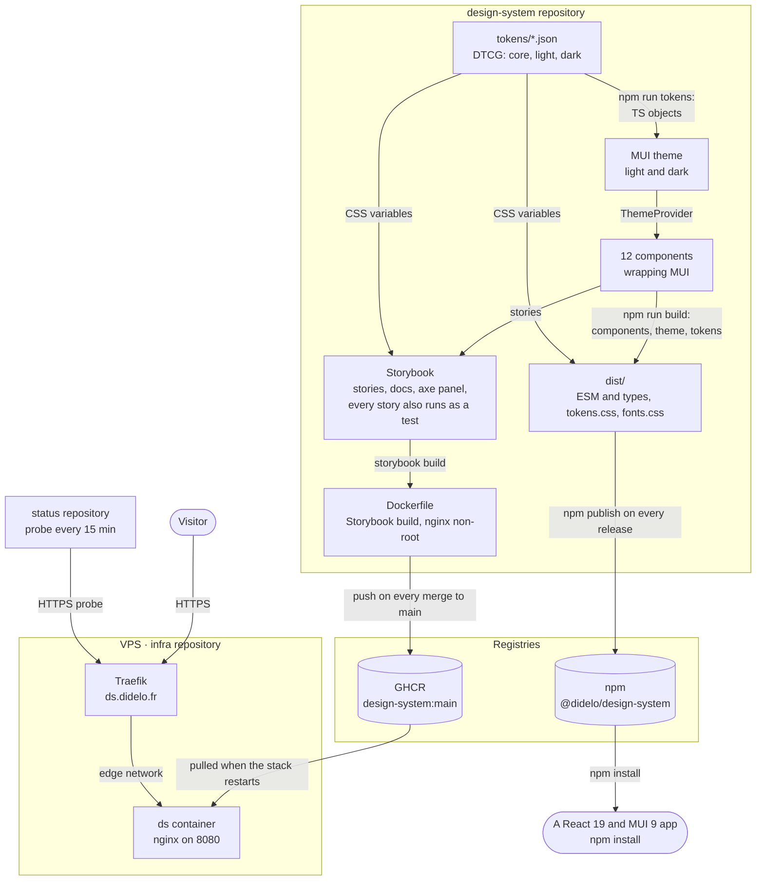
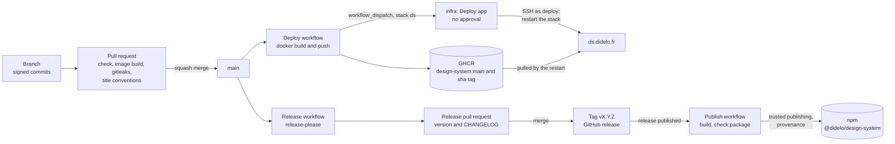

# design-system

[](https://www.npmjs.com/package/@didelo/design-system)
[](https://github.com/Didelo-lilian/design-system/releases)
[](https://github.com/Didelo-lilian/design-system/actions/workflows/ci.yml)
[](LICENSE)

A design system on MUI and React: design tokens, accessible components and automated tests, documented in Storybook and reused by my other projects.

> **Status:** 1.0. The Storybook is live at https://ds.didelo.fr and follows `main`; the package is on npm as [`@didelo/design-system`](https://www.npmjs.com/package/@didelo/design-system). Follow the [roadmap](https://github.com/orgs/Didelo-lilian/projects/1).

## What it is

| Layer | Choice |
|---|---|
| Components | React 19 and MUI 9, a dozen components that wrap MUI instead of reimplementing it |
| Tokens | One JSON source in the DTCG format, built into CSS variables and the MUI theme, light and dark |
| Documentation | Storybook, built into an nginx image on every merge to `main` and served behind Traefik on the [VPS](https://github.com/Didelo-lilian/infra) |
| Tests | Stories run as tests in a real browser, axe accessibility checks, screenshot regression |
| Release | release-please for versions and changelog, published to npm from CI with a provenance statement |

## Architecture

What exists today. The diagram is updated in the same pull request as any change it shows.



No project of mine installs the package yet: [`status`](https://github.com/Didelo-lilian/status) only probes the Storybook page, and the front end of [`semaphore`](https://github.com/Didelo-lilian/semaphore), not built yet, will be the first to install it.

## Install

```bash
npm install @didelo/design-system @mui/material @mui/icons-material @emotion/react @emotion/styled react react-dom
```

React 19 and MUI 9 are peer dependencies. The package is ESM only and ships its type declarations.

```tsx
import { Button, theme } from "@didelo/design-system";
import "@didelo/design-system/fonts.css"; // Bricolage Grotesque, Figtree and JetBrains Mono, self-hosted
import "@didelo/design-system/tokens.css"; // the design tokens as CSS custom properties (optional)
import { CssBaseline, ThemeProvider } from "@mui/material";

export const App = () => (
  <ThemeProvider theme={theme}>
    <CssBaseline />
    <Button variant="contained">Save</Button>
  </ThemeProvider>
);
```

The theme has a light and a dark color scheme, switched with the `data-theme` attribute (`<html data-theme="dark">`) or MUI's `useColorScheme`.

## Delivery

Every merge to `main` rebuilds and redeploys the Storybook; the package is published only when a release pull request is merged.



## Releases

[release-please](https://github.com/googleapis/release-please) reads the Conventional Commits on `main` and keeps a release pull request up to date (version and `CHANGELOG.md`). Merging it tags the version and creates the GitHub release, which publishes the package to npm from CI with a provenance statement (`.github/workflows/publish.yml`).

## Run it

Requirements: Node 24 (`.nvmrc`), and gitleaks for `make check`.

```bash
npm ci && npm run storybook   # Storybook on http://localhost:6006
make check                    # same checks as CI: lint, type check, tests in chromium, Storybook build, gitleaks
npm test                      # unit tests, then every story in a real browser, in light and dark: its play function and an axe check
VISUAL=1 npm test             # also compare the screenshots (the baselines are Linux renderings, see below)
docker build -t design-system .   # Storybook as an nginx image
docker run --rm -p 8080:8080 design-system   # served on http://localhost:8080
```

## Changelog

Versions follow [SemVer](https://semver.org) and are cut by [release-please](https://github.com/googleapis/release-please) from the Conventional Commit titles of merged pull requests. Never edited by hand:
- [`CHANGELOG.md`](CHANGELOG.md): every release, grouped by type;
- [Releases](https://github.com/Didelo-lilian/design-system/releases): notes and tags.

## Visual regression

In CI every story is also screenshotted, in light and dark, and compared with the baseline committed next to the stories (`src/**/__screenshots__/<file>/<theme>/<story>.png`). A difference fails the CI, which uploads the `screenshot-diffs` artifact with the diff images.

The baselines are rendered on Linux, as in CI: fonts and anti-aliasing differ on macOS, so locally the check is skipped unless `VISUAL=1`.

To update the baselines after a wanted visual change:

1. Add the `update-screenshots` label to your pull request: the **Update screenshots** workflow regenerates every baseline on Linux (`gh pr edit <number> --add-label update-screenshots`; remove and re-add the label to run it again).
2. Download the `screenshots` artifact of that run (`gh run download <run-id> -n screenshots`), copy the `__screenshots__` folders over `src/`, and commit them with the change.
3. Look at the changed images in the PR diff before merging.

## How I built this

Built incrementally, one weekend at a time, with [Claude Code](https://claude.com/claude-code) as a pair: I write the issues and decisions, review every change and keep the history honest.

## License

[MIT](LICENSE)
